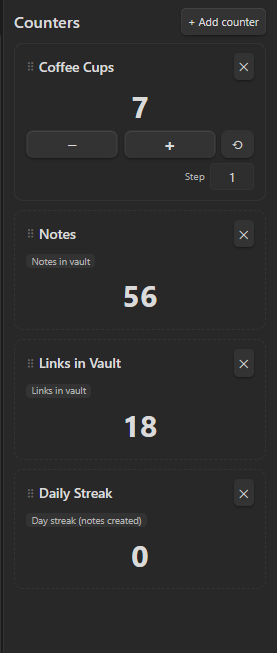

# Custom Counter

Simple tally counters in the right sidebar — like the lap counters runners used to click at the track. Add as many as you want, each with its own name, count, and step size.

Docs & download: https://30jannik06.github.io/Obsidian-Counter/

## Install (manual / dev)

1. `npm install`
2. `npm run build` (or `npm run dev` for watch mode)
3. Make sure this folder sits at `<vault>/.obsidian/plugins/custom-counter/`
4. Reload Obsidian, enable "Custom Counter" in Settings → Community plugins

## Use

- Ribbon icon or command "Open counters panel" opens the sidebar view.
- "+ Add counter" creates a new one — give it a name.
- Click the name to rename, ✕ to delete.
- Big **+** / **−** buttons change the count by the step size (default 1); set a custom step per counter.
- ⟲ resets a counter to 0.

Everything is saved automatically to the plugin's data file.

### Automatic counters

Instead of manual, pick "Automatic" when adding a counter to track a live vault stat instead: notes in vault, total links, tags used, attachments, or a day-streak of note creation. These update themselves when the vault changes — no clicking needed.

### Reordering

Drag a card by its `⠿` handle to reorder counters.

## Releasing a new version

1. Bump `version` in `package.json`, then run `npm run version` (updates `manifest.json` and `versions.json` to match, via `version-bump.mjs`).
2. Commit, then tag the commit with the version number (e.g. `git tag 1.1.0 && git push --tags`).
3. The `.github/workflows/release.yml` workflow builds the plugin and publishes a GitHub release with `main.js`, `manifest.json`, and `styles.css` attached — ready for manual install or BRAT.
